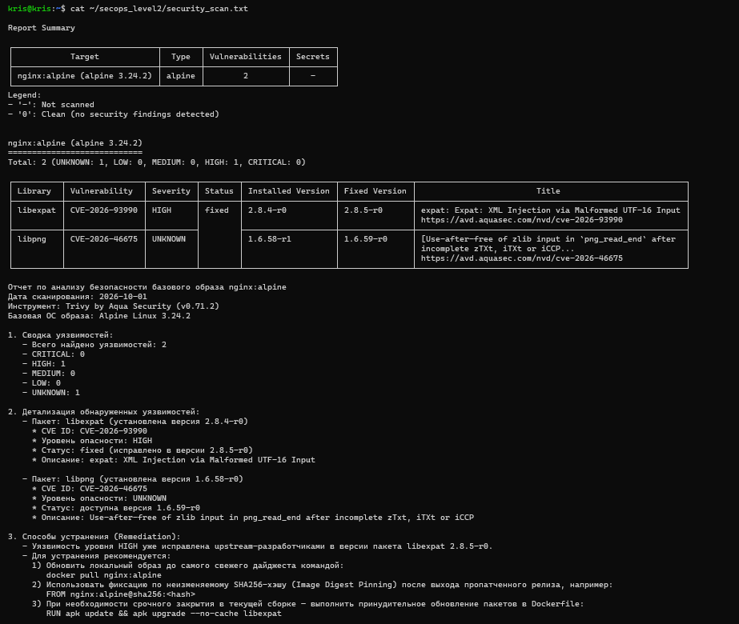
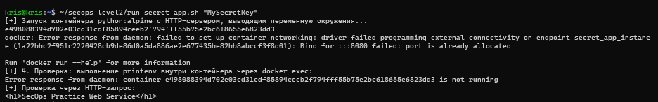
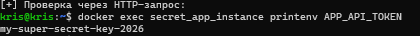
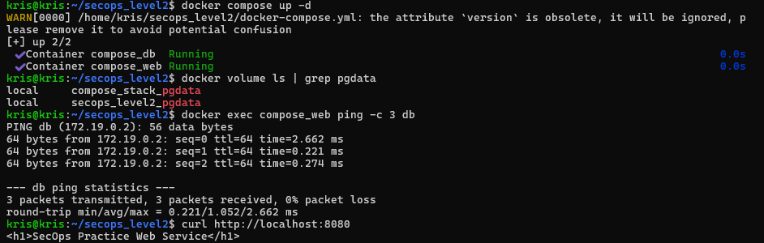
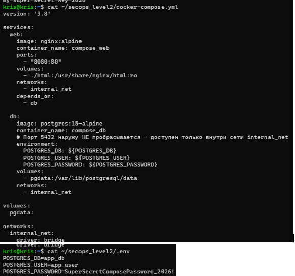
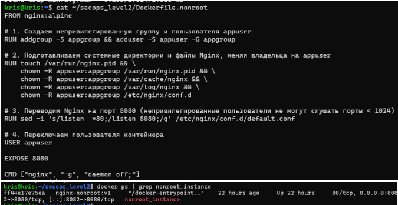
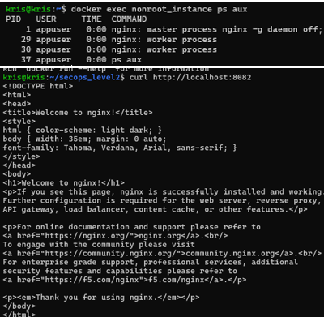

# Практическая работа: Security Champion / DevOps (Уровень 2)
Репозиторий содержит решение практических задач второго уровня: аудит уязвимостей базовых образов, безопасная работа с секретами, декларативное описание инфраструктуры через Docker Compose и применение принципа наименьших привилегий (Non-root контейнеры).

---

## Структура проекта

* `security_scan.txt` — результат сканирования безопасности и отчет по анализу уязвимостей базового образа `nginx:alpine` с помощью Trivy.
* `run_secret_app.sh` — Bash-скрипт запуска веб-приложения на базе `python:alpine`, принимающий API-токен аргументом командной строки и передающий его через переменные окружения без хардкода.
* `docker-compose.yml` — манифест оркестрации изолированного стека из веб-сервера (Nginx) и базы данных (PostgreSQL 15).
* `.env` — конфигурационный файл с паролями и переменными окружения (добавлен в `.gitignore` во избежание утечки учетных данных).
* `html/index.html` — статическая страница веб-сервиса, монтируемая в Nginx.
* `Dockerfile.nonroot` — инструкция сборки защищенного образа Nginx, работающего от непривилегированного пользователя `appuser` на порту 8080.
* `.gitignore` — исключение чувствительных файлов (`.env`) из системы контроля версий.

---


### Задание 2.1: Анализ безопасности базового образа (Trivy)
Файл `security_scan.txt` содержит вывод сканера Trivy и детализацию уязвимостей CVE (в частности, `CVE-2026-93990` в пакете `libexpat`), а также рекомендации по их устранению (digest pinning и обновление пакетов).
* 
  ```bash
  cat security_scan.txt
  ```



### Задание 2.2: Безопасная работа с секретами
Скрипт run_secret_app.sh принимает токен как аргумент ($1), очищает старый инстанс и поднимает сервис на Python с передачей значения в переменную окружения APP_API_TOKEN.

* Запуск скрипта с передачей ключа:
  ```bash
	chmod +x run_secret_app.sh
	./run_secret_app.sh "my-super-secret-key-2026"
  ```



* Проверка попадания переменной внутрь контейнера
  ```bash
	docker exec secret_app_instance printenv APP_API_TOKEN
  ```


### Задание 2.3: Декларативный стек через Docker Compose
Сервисы объединены в общую виртуальную сеть internal_net. Порт СУБД 5432 закрыт от внешней сети хоста и доступен только сервису web. Персистентность данных обеспечивается именованным томом pgdata.

* Запуск стека в фоновом режиме:
* Проверка создания именованного тома
* проверка изоляции и сетевой связности  WEB➔ DB по имени сервиса:
* Проверка работы веб-сервера



* Файл docker-compose.yml  и Файл .env с паролем БД и .gitignore



### Задание 2.4: Принцип наименьших привилегий (Dockerfile.nonroot)
В Dockerfile.nonroot создается непривилегированный пользователь appuser, перенастраиваются права на системные каталоги (/var/cache/nginx, /var/run, /var/log/nginx) и порт изменяется на 8080.

* Файл Dockerfile.nonroot
* Запуск контейнера из non-root образа  docker ps | grep nonroot_instance
* Процессы внутри идут не от root 
* Проверка доступности страницы




